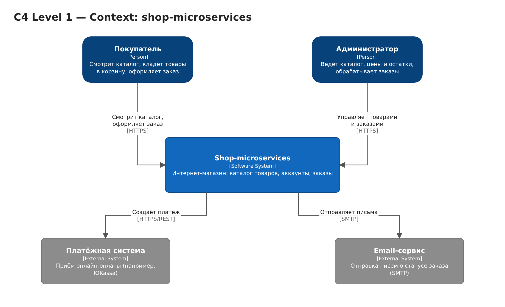
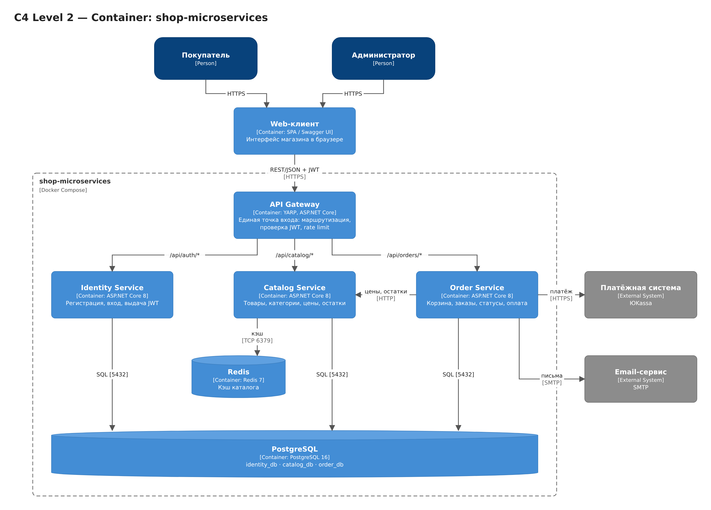
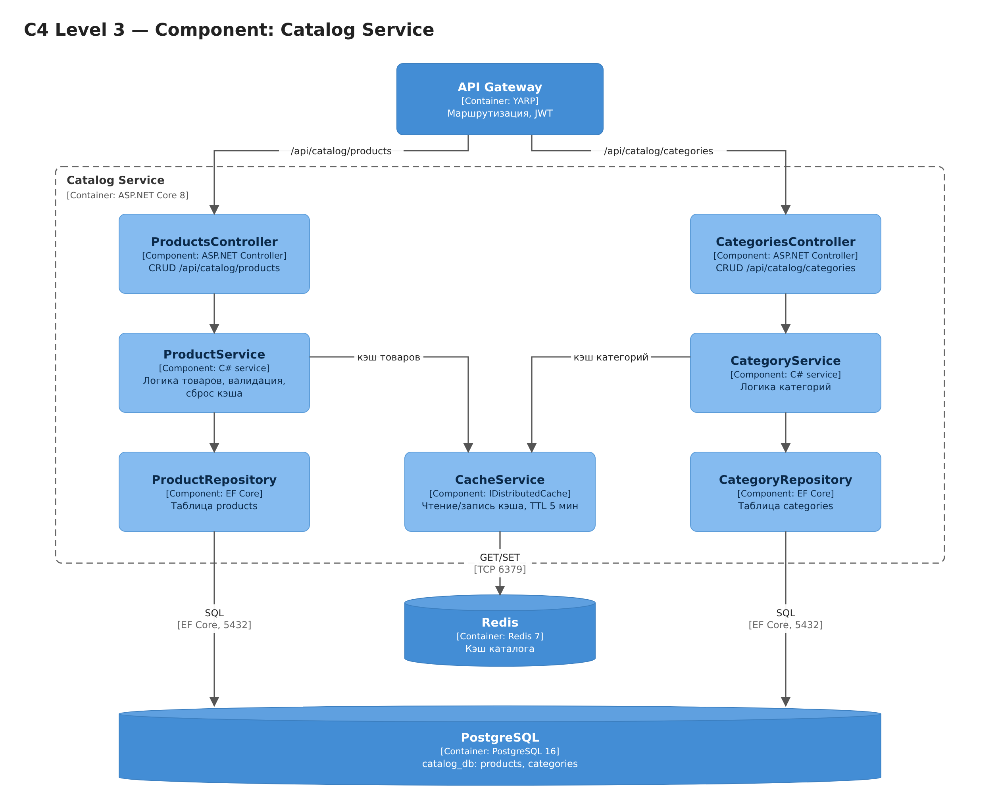

# shop-microservices — архитектура (C4)

## Описание системы

**shop-microservices** — это бэкенд интернет-магазина на микросервисах (.NET). Покупатель смотрит каталог, регистрируется и оформляет заказ с онлайн-оплатой. Администратор ведёт каталог (товары, категории, цены, остатки) и обрабатывает заказы. Все запросы клиента идут через единую точку входа — **API Gateway**. Данные хранятся в **PostgreSQL**, а самые частые запросы (просмотр каталога) кэшируются в **Redis**.

## Основной пользовательский сценарий

> Покупатель открывает каталог, выбирает товар и оформляет заказ.

1. Web-клиент отправляет `GET /api/catalog/products` → **API Gateway** → **Catalog Service**.
2. Catalog Service сначала ищет список в **Redis**. Если данные есть (cache hit), он сразу отдаёт ответ. Если нет (cache miss), читает их из **PostgreSQL** (`catalog_db`) и кладёт в Redis с TTL 5 минут.
3. Покупатель входит в аккаунт: `POST /api/auth/login` → **Identity Service** проверяет пароль в `identity_db` и выдаёт JWT.
4. Покупатель оформляет заказ: `POST /api/orders` с JWT → Gateway проверяет токен → **Order Service**.
5. Order Service запрашивает у Catalog Service актуальные цены и остатки, сохраняет заказ в `order_db` и создаёт платёж в **платёжной системе**.
6. После оплаты Order Service меняет статус заказа и отправляет письмо покупателю через **Email-сервис**.

---

## C4 Level 1 — Context



Система показана как «чёрный ящик». На схеме видно, кто ей пользуется и с какими внешними системами она связана.

| Элемент | Тип | Роль |
|---|---|---|
| Покупатель | Person | Смотрит каталог, оформляет и оплачивает заказы |
| Администратор | Person | Управляет товарами, ценами, остатками и заказами |
| Shop-microservices | Software System | Сама система интернет-магазина |
| Платёжная система | External System | Принимает онлайн-оплату (например, ЮKassa) |
| Email-сервис | External System | Отправляет письма о статусе заказа (SMTP) |

---

## C4 Level 2 — Container



Крупные части системы. Всё, что внутри пунктирной рамки, запускается через **Docker Compose**.

| Контейнер | Технология | Роль |
|---|---|---|
| Web-клиент | SPA / Swagger UI | Интерфейс в браузере, вызывает только API Gateway |
| **API Gateway** | YARP (ASP.NET Core) | Единая точка входа: маршрутизирует запросы по префиксу, проверяет JWT, ограничивает частоту запросов (rate limit), пишет логи |
| Identity Service | ASP.NET Core 8 | Регистрация, вход, выдача JWT |
| Catalog Service | ASP.NET Core 8 | Товары, категории, цены, остатки |
| Order Service | ASP.NET Core 8 | Корзина, заказы, статусы, интеграция с оплатой и почтой |
| **PostgreSQL 16** | СУБД | Основное хранилище. У каждого сервиса своя БД: `identity_db`, `catalog_db`, `order_db` |
| **Redis 7** | In-memory cache | Кэш каталога для Catalog Service |

Маршрутизация в API Gateway:

| Путь | Сервис |
|---|---|
| `/api/auth/*` | Identity Service |
| `/api/catalog/*` | Catalog Service |
| `/api/orders/*` | Order Service |

Внутри Docker Compose сервисы обращаются друг к другу по имени: `http://catalog-service:8080`, `postgres:5432`, `redis:6379`.

---

## C4 Level 3 — Component (Catalog Service)



Внутреннее устройство одного сервиса — **Catalog Service**. Код разделён на три слоя: Controllers → Services → Repositories.

| Компонент | Роль |
|---|---|
| ProductsController | HTTP-эндпоинты CRUD для товаров (`/api/catalog/products`) |
| CategoriesController | HTTP-эндпоинты CRUD для категорий (`/api/catalog/categories`) |
| ProductService | Бизнес-логика товаров: валидация, работа с кэшем, сброс кэша при изменении |
| CategoryService | Бизнес-логика категорий |
| ProductRepository | Доступ к таблице `products` через EF Core |
| CategoryRepository | Доступ к таблице `categories` через EF Core |
| CacheService | Обёртка над `IDistributedCache`: чтение и запись в Redis, TTL 5 минут |

Как работает кэш:
- **Чтение** (`GET`): сервис проверяет CacheService. При промахе берёт данные из репозитория и кладёт их в кэш.
- **Запись** (`POST/PUT/DELETE`): сервис меняет данные в PostgreSQL и удаляет соответствующий ключ из Redis, чтобы клиенты не получили устаревшие данные.

---

## Почему выбраны эти компоненты

**API Gateway.** Без него клиенту пришлось бы знать адреса всех трёх сервисов. Gateway скрывает внутреннюю структуру системы, проверяет JWT в одном месте (сервисам не нужно дублировать эту логику), ограничивает частоту запросов и пишет логи. YARP выбран, потому что он написан на .NET, как и весь проект, и настраивается через `appsettings.json`.

**PostgreSQL.** Это реляционная БД с транзакциями. Для магазина это важно: заказ, его позиции и списание остатков должны сохраняться целиком или не сохраняться совсем. Принцип «database per service» сделан через отдельные базы в одном экземпляре PostgreSQL: сервисы не лезут в чужие таблицы, но в учебном проекте не нужно поднимать три сервера.

**Redis (cache) — дополнительный компонент.** Каталог читают намного чаще, чем меняют: каждый покупатель открывает списки товаров, а цены и остатки администратор правит редко. Поэтому кэш каталога в Redis:
- снижает нагрузку на PostgreSQL;
- ускоряет ответ на самые частые запросы;
- остаётся общим для всех экземпляров Catalog Service, если масштабировать его горизонтально (в отличие от in-memory кэша внутри процесса).

Очередь (RabbitMQ) пока не нужна: отправку письма можно сделать позже как следующий шаг развития (`OrderPaid` → очередь → Email worker).

---

## Файлы

```
README.md                 — это описание
docs/architecture.drawio  — исходник схем (3 страницы: Context, Container, Component)
docs/c4-1-context.png     — экспорт Level 1
docs/c4-2-container.png   — экспорт Level 2
docs/c4-3-component.png   — экспорт Level 3
```

Исходник открывается на [app.diagrams.net](https://app.diagrams.net) (File → Open from → Device) или в draw.io Desktop. Каждый уровень C4 лежит на своей вкладке внизу.
